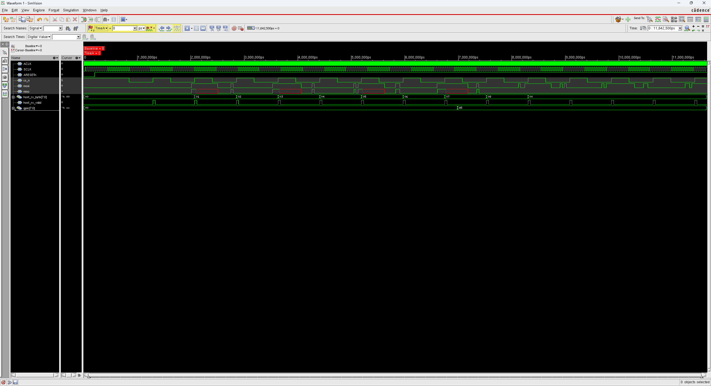
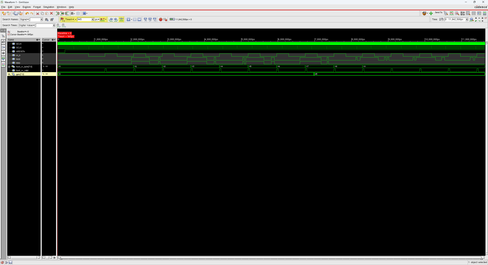

# 17. Post-layout GLS (PnR 넷리스트 + Tempus SDF, Xcelium)

## 실행

```
cd TOP/SIM/POST/max   →  source run_post_max.tcl   (SS, chip_top_post_wst.sdf)
cd TOP/SIM/POST/min   →  source run_post_min.tcl   (FF, chip_top_post_bst.sdf)
```

| 항목 | 값 |
|---|---|
| 넷리스트 | `chip_top_pnr_hier.v` (계층 유지, `hier_netlist.tcl`) — SDF 인스턴스 이름이 계층이라 flat 넷리스트로는 annotate 안 됨 |
| 셀 모델 | max: slow basicCells + `pads_SS_s1vg.v` / min: fast + `pads_FF_s1vg.v` (`-v`) |
| 전원 패드 | `pad_supply_stubs.v` (빈 모듈 4종) |
| 타이밍 체크 | `cdc_tcheck_off.tfile` — 동기화기 첫 단 24개만 off (RX 포인터 5비트, TX 포인터 3비트, pulse_sync, busy, reset_sync × 3 × 2) |

## 결과

| 항목 | max (SS) | min (FF) |
|---|---|---|
| GPIO = 0xA5 | **PASS @ 6,995 ns** | **PASS @ 6,995 ns** |
| MISO 에코 0x01..0x08 | PASS | PASS |
| 최종 | ALL TESTS PASSED | ALL TESTS PASSED |
| SDF path delay 적용 | 14,035 / 14,035 (100 %) | 100 % |
| `$setuphold` 적용 | 5,523 / 5,523 | 같음 |
| Timing violation | 14 (보드 지연 없는 구 TB, 아래) | **0** |




- **What** — 위 SS(최악 지연), 아래 FF(최소 지연), 전체 11.6 µs.
- **Observe** — 두 코너 모두 프레임 8개, `gpio` 00 → A5, 같은 시각에 판정.
- **Insight** — 지연이 3.5배 차이 나도 판정 시각이 같다는 것은 칩이 모든 코너에서 같은 사이클에
  같은 일을 한다는 뜻입니다 (동기 설계).

## SS 실행의 hold 경고 14개 — TB 문제

- 전부 `u_spi_slave/state_reg_1`, SPI 프레임마다 1번 (779 ns = SCLK 19주기마다).
  `$setuphold<hold>(posedge CK : t, negedge D : t + 32 ps, limit 40 ps)`.
- 호스트 모델이 SCLK 엣지와 **같은 순간**에 CS_n을 바꿔, 칩 안에서 데이터가 클럭보다 32 ps 늦게 도착.
  SDC는 `set_input_delay -min 0.5`로 "엣지 후 최소 0.5 ns"를 약속했고 Tempus는 그 가정에서 hold를 사인오프.
- **해결** — `tb_chip_top.v`에 호스트 → 핀 보드 지연 `HOST_IO_DLY = 1.0 ns` (SDC 범위 0.5~2.0 ns 안).
  min 실행과 08 Pre GLS는 새 TB로 돌려 위반 0. **max 로그와 캡처는 구 TB 결과**입니다
  (MISO X 구간도 같은 원인). 기능 판정은 그대로 PASS.

## SDFNET (RECREM) 경고

Tempus SDF는 recovery/removal을 하나의 `RECREM`으로 쓰고, gsclib045 Verilog 모델은 `$recovery` /
`$hold`(RN)를 따로 정의해 annotate되지 않습니다 (max 356, min 359). 이 검사는 Tempus
30_recovery / 31_removal에서 위반 0으로 사인오프했습니다.

## 파일

```
17_Post_Layout_Sim/
├── README.md
│
├── scripts/   run_post_max.tcl, run_post_min.tcl, cdc_tcheck_off.tfile,
│              pad_supply_stubs.v, hier_netlist.tcl, tb_chip_top.v
│
├── reports/   post_sim_max.log, post_sim_min.log, sdf_max.log, sdf_min.log
│
├── images/    17_gls_max_SS_full.png, 17_gls_min_FF_full.png
│
└── results/   gls_summary.md, sclk_to_miso_delay.md
```
