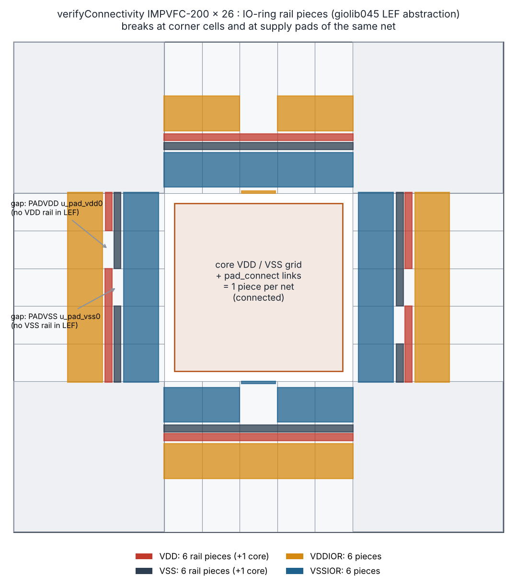

# 18. Final Verification (DRC / Connectivity)

## 결과

| 검사 | 결과 |
|---|---|
| `verify_drc` (ChipFinish 후) | **0 violation** (`reports/chip_top_final.drc.rpt`) |
| `verifyConnectivity` 신호 넷 | open 0 |
| `verifyConnectivity` 전원 | `IMPVFC-200` **26** (IO 링) + VSS M3 길이 0 조각 1 |
| LVS | **하지 않음** (Pegasus/PVS 사용 안 함) |
| 기능 등가 | 13_Post_LEC PASS |
| 타이밍 | 15_Post_STA 위반 0 |

## IMPVFC-200 26개 — IO 링 레일 끊김 표시



- **What** — `IMPVFC-200` 마커 위치를 패드 링 위에 표시.
- **Observe** — 마커는 모두 (a) 코너 셀 경계, (b) 같은 넷의 전원 패드 양옆에 있고 코어 안에는 없습니다.
- **원인** — giolib045 LEF는 패드 · 코너의 IO 링 레일을 추상화해 셀 경계에서 레일이 끝나는 핀으로만
  표현합니다. `sroute -connect padRing`이 440개 와이어로 패드 사이를 잇지만, 코너와 전원 패드에서
  끊긴 것으로 검사됩니다.
- **판단** — 실제 칩에서는 패드 · 코너의 레일이 셀 안에서 이어지므로 LEF 추상화 한계로 봅니다.
  다만 이 판단은 **GDS 레벨 LVS로 확인하지 않았습니다.** 다이 800 + IO 필러 버전의 131개에서
  패드를 맞붙여 26개로 줄였습니다 (09 참고).

## VSS 조각 1개

- (512, 355.455) 근처 M3, 길이 0. `pad_connect.tcl`이 오른쪽 VSS 패드 링크를 그을 때
  코어 링 끝에 남긴 것으로 보입니다. 연결된 넷의 일부이며 DRC 0.
- 지우려면 Innovus `editDelete -shape` 또는 `pad_connect.tcl`의 끝점을 1 µm 줄여 다시 실행.

## 파일

```
18_Final_Verification/
├── README.md
├── reports/   chip_top_final.drc.rpt
└── images/    18_io_ring_open_map.png
```
