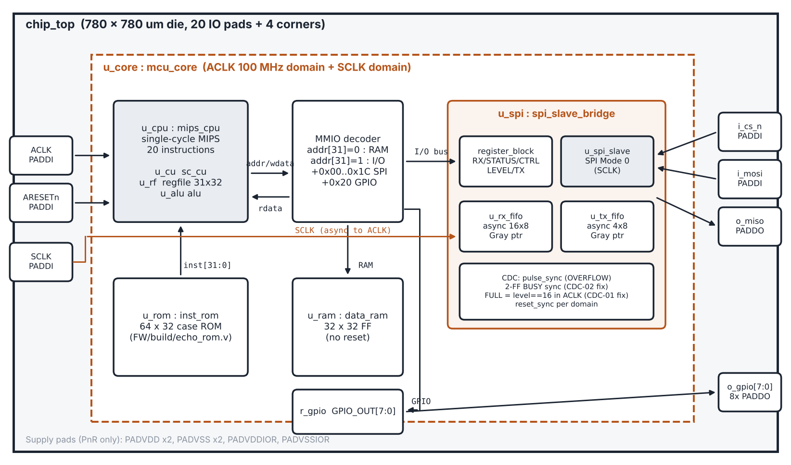

# MIPS MCU + SPI Slave — RTL to GDS (GPDK045, IO Pads)

싱글 사이클 MIPS CPU(Yamin Li 책)에 이전 프로젝트의 **SPI Slave + Async FIFO CDC 브릿지**를
메모리 맵 I/O로 붙이고, 이전에 남겼던 **CDC-01 / CDC-02를 고친 뒤**, IO 패드 링까지 넣어
합성 → PnR → 사인오프 → GLS까지 진행한 프로젝트입니다.



## 결과 한눈에

| 항목 | 결과 |
|---|---|
| 기능 | 펌웨어(`echo.s`)로 SPI 8바이트 에코 → GPIO `0xA5`. **RTL / Pre GLS / Post GLS SS·FF 모두 6,995 ns에 PASS** |
| CDC | CDC-01 (STATUS.FULL을 ACLK 도메인에서 계산), CDC-02 (BUSY를 SCLK 플롭 → 2-FF) 수정, 파형 확인 |
| 합성 | 6,775 셀 (순차 2,368), 코어 26,984 µm², SS setup +1.4 ps |
| PnR | 다이 780 µm (패드 20 + 코너 4), 코어 240 µm, 밀도 35.9 %, CTS 버퍼 117 |
| 사인오프 (Tempus) | setup **+0.676 ns** / hold **+0.051 ns** / recovery +8.732 / removal +0.054, 위반 0 |
| LEC | RTL↔SYN PASS, SYN↔PnR PASS (1,609 Equivalent) |
| DRC | 0 |
| 전력 (SS 정적) | 4.79 mW (패드 84 %) |

## 챕터

| # | 챕터 | 핵심 |
|---|---|---|
| 00 | [Specification](00_Specification) | ISA 20개, 메모리 맵, SPI 레지스터, 핀, 펌웨어 |
| 01 | [Architecture](01_Architecture) | 블록 / 계층 / 클럭 도메인 / 패드 링 평면 |
| 02 | [RTL](02_RTL) | Verilog-2001 13개 + 어셈블러 · ISS |
| 03 | [Functional Verification](03_Functional_Verification) | 4개 TB, 파형 7장 (CDC-01/02 확인) |
| 04 | [Synthesis](04_Synthesis) | Genus MMMC, ROM/CPU 경계 보존으로 regfile 992 플롭 유지 |
| 05 | [DFT](05_DFT) | 미적용 (이유) |
| 06 | [Pre-LEC](06_Pre_LEC) | RTL ↔ SYN PASS |
| 07 | [Pre-STA](07_Pre_STA) | Genus 타이밍, pre vs post |
| 08 | [Pre-layout Sim](08_Pre_Layout_Sim) | SDF GLS PASS, 위반 0 |
| 09 | [Floorplan](09_Floorplan) | **패드 링 디버그 4건**: coreMarginsBy die, pad_connect, 다이 780, 전원 패드 자동 추가 |
| 10 | [Placement](10_Placement) | preCTS +0.351 ns |
| 11 | [CTS](11_CTS) | **버퍼 0개 → 117개** (`set_ideal_network` 문제) |
| 12 | [Routing](12_Routing) | postRoute +0.677 / +0.051, DRC 0, 전력 |
| 13 | [Post-LEC](13_Post_LEC) | SYN ↔ PnR PASS |
| 14 | [RC Extraction](14_RC_Extraction) | real net RC 100 % |
| 15 | [Post-STA](15_Post_STA) | Tempus 사인오프, 커버리지, SDF |
| 16 | [Timing Closure](16_Timing_Closure) | 위반 0 → ECO 불필요, ideal network 수정 전후 |
| 17 | [Post-layout Sim](17_Post_Layout_Sim) | SS / FF GLS PASS, TB 보드 지연 |
| 18 | [Final Verification](18_Final_Verification) | DRC 0, IO 링 IMPVFC-200 26 분석 |
| 19 | [Final Results](19_Final_Results) | 요약 · 차트 · 남은 과제 |

## 서버 디렉터리 (이전 SPI 프로젝트 구조 복사)

```
TOP/
├── RTL/          RTL 13개
├── FW/           어셈블러, ISS, echo.s → build/echo_rom.v
│
├── SIM/
│   ├── FUNCTION/  CPU/  MCU/  CHIP/     RTL 시뮬레이션
│   ├── TESTBENCH/                       TB 공용
│   ├── PRE/                             합성 넷리스트 GLS
│   └── POST/{max,min}/                  PnR 넷리스트 GLS
│
├── SYN/          Genus
├── EC/           Conformal LEC
├── PNR/          Innovus + Tempus
└── PNR_HOLDECO/  (이번에는 사용 안 함)
```

## 툴

Xcelium · SimVision · Genus 22.17 · Conformal LEC 22.1 · Innovus 22.17 · Tempus 22.17 — GPDK045 (gsclib045, giolib045)

> PDK 파일(GPDK045 폴더 내용)은 저장소에 포함하지 않았습니다. 스크립트 안의 경로 문자열만 남아 있습니다.

## 하지 않은 것

DFT · LVS · Quantus SPEF · Tempus pre-STA는 진행하지 않았고, LEC Unreachable 768개의 정체와
보드 지연 반영 후 SS Post GLS 재실행이 남았습니다. 자세한 내용은 [19](19_Final_Results).
